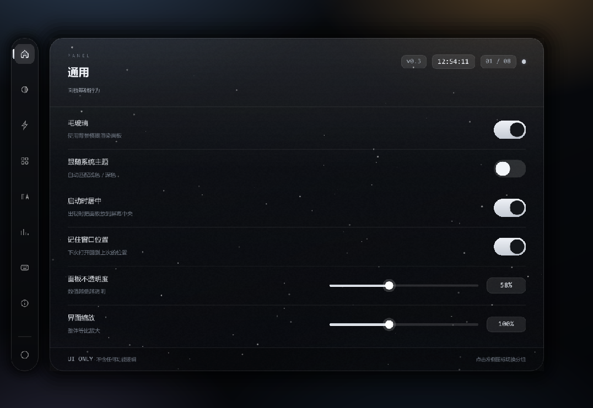

# Panel UI · C++ / Dear ImGui 版

把原来那份单文件 `ui-panel.html`（HTML + CSS + JS 的黑色透明玻璃控制面板）完整移植成
原生 C++ 程序：**Win32 无边框窗口 + Direct3D 11 + Dear ImGui 自绘**。

零框架依赖，只额外带了 Dear ImGui 一份源码；界面没有用 ImGui 的标准控件，而是照着
CSS 逐条手绘（圆角玻璃、渐变、开关弹簧、滑杆、雪花、波纹……），保证和网页版观感一致。



---

## 打开与编译

用 Visual Studio 打开 `PanelUI.sln`，选 `x64` + `Release`，直接 F5。

| 项 | 值 |
|---|---|
| 平台工具集 | v143（VS2022 / VS2026 均可；只装了 v145 时右键解决方案 →「重定目标解决方案」） |
| C++ 标准 | C++20（`sections.cpp` 用了指定初始化器） |
| 字符集 | Unicode，源文件 UTF-8（编译选项带 `/utf-8`） |
| 链接库 | d3d11 / dxgi / dwmapi / d3dcompiler / advapi32 |

命令行编译（无 MSBuild 时也可）：

```powershell
msbuild PanelUI.sln /p:Configuration=Release /p:Platform=x64
```

产物在 `bin\x64\Release\PanelUI.exe`。

### 关于 CVT1100 / LNK1122「资源重复」

工程的应用程序清单是放在 `PanelUI/res/PanelUI.rc` 里，用 `1 24 "PanelUI.manifest"`
（`CREATEPROCESS_MANIFEST_RESOURCE_ID` + `RT_MANIFEST`）随资源一起嵌入的，这样做是为了
写入 `permonitorv2` 的 DPI 感知声明。因此 vcxproj 里把链接器自动生成清单关掉了——
**注意必须是「工程属性」，不能写在 `<Link>` 的 ItemDefinitionGroup 里**：

```xml
<PropertyGroup Label="Configuration">
  <GenerateManifest>false</GenerateManifest>   <!-- 链接器 → 清单文件 → 生成清单：否 -->
  <EmbedManifest>false</EmbedManifest>         <!-- 链接器 → 清单文件 → 嵌入清单：否 -->
</PropertyGroup>
```

原因是 MSBuild 把 `GenerateManifest` 作为**工程属性**传给链接器任务
（`Microsoft.CppCommon.targets` 里 `GenerateManifest ="$(GenerateManifest)"`），
写在 `<Link>` 下面的同名元数据会被忽略。只要链接器还嵌着自己那份，二进制里就会出现两个
`MANIFEST / ID 1 / 0x0409`，于是报

```
CVT1100 资源重复。类型: MANIFEST，名称: 1，语言: 0x0409
LNK1122 转换到 COFF 期间失败: 文件无效或损坏
```

改完后如果 VS 还报同样的错，多半是工程文件是在外部改的、VS 没重载：关闭解决方案重新打开，
或「生成 → 清理解决方案」后再生成。

两种改法任选其一：保持上面两个属性为 false（推荐，清单已在 .rc 里），或者把 `.rc`
里那行 `1 24 "PanelUI.manifest"` 删掉，改用链接器生成的默认清单（但那样就只剩
`true/pm`，拿不到 per-monitor-v2）。

## 目录结构

```
pane UI/
├── PanelUI.sln
├── README.md
├── docs/preview.png
├── PanelUI/
│   ├── PanelUI.vcxproj
│   ├── PanelUI.vcxproj.filters
│   ├── src/
│   │   ├── main.cpp        程序入口（wWinMain）
│   │   ├── app.h/.cpp      窗口、D3D11 设备、ImGui 主循环、窗口位置记忆
│   │   ├── backdrop.h/.cpp 壁纸着色器 + 可分离高斯模糊链（模拟 backdrop-filter）
│   │   ├── panel.h/.cpp    布局与全部界面绘制（对应 HTML 的 DOM + CSS）
│   │   ├── sections.h/.cpp 8 个分组 × 6 行的数据表（对应 JS 的 SECTIONS）
│   │   ├── state.h/.cpp    运行时状态与动画数据
│   │   ├── widgets.h/.cpp  开关 / 滑杆 / 键帽 / 波纹
│   │   ├── draw2d.h/.cpp   缓动曲线与手绘图元（圆角渐变、柔和投影、字距）
│   │   ├── icons.h/.cpp    左侧图标栏的矢量图标（原内联 SVG）
│   │   ├── snow.h/.cpp     雪花粒子
│   │   ├── fonts.h/.cpp    字体装载（Segoe UI + 微软雅黑 + Consolas）
│   │   └── theme.h         两套配色（对应 CSS 变量）
│   └── res/                PanelUI.rc / 图标 / 清单
└── third_party/imgui/      Dear ImGui 1.92.4（含 dx11 + win32 后端）
```

## HTML → C++ 对照

| 原网页 | 现在的实现 |
|---|---|
| `:root` 与 `html[data-theme="night"]` 的 CSS 变量 | `theme.h` 的 `MakeLightTheme()` / `MakeNightTheme()` |
| `.stage` 的四层径向渐变 + 线性底色 | `backdrop.cpp` 里的 `PSWallpaper`（HLSL 逐像素还原） |
| `backdrop-filter: blur(54px) saturate(180%)` | `backdrop.cpp`：1/4 分辨率可分离高斯，迭代次数由模糊半径换算 |
| `.panel` 玻璃渐变 / 描边 / 顶部高光 / 噪点 | `panel.cpp::DrawPanel()` |
| `.rail` 图标栏、`.rail__tip` 提示 | `panel.cpp::DrawRail()` / `DrawTooltip()` |
| `.head` / `.body` / `.row` / `.foot` | `DrawHead()` / `DrawBody()` / `Row()` / `DrawFoot()` |
| `.switch` 开关 | `widgets.cpp::SwitchDraw()`（弹簧积分，带过冲） |
| `input[type="range"]` 滑杆 | `widgets.cpp::SliderDraw()`（渐变轨道 + 白色圆钮 + 数值胶囊） |
| `.kbd` 键帽 / `.meta-value` | `widgets.cpp::Kbd()` / `Row()` 里的 Meta 分支 |
| `<canvas id="snow">` 雪花 | `snow.cpp`（同一套密度/速度/正弦漂移参数） |
| `.fx-ripple` 点击波纹 | `widgets.cpp::Ripple()` |
| `SECTIONS` 数组 | `sections.cpp::kSections` |
| `state` 对象 + `applyEffect()` | `state.h::UiState` + 各控件回调 |

## 和网页版的差别

- **模糊是真的**：网页版的 `backdrop-filter` 只能模糊页面自身背景；这里先用 HLSL 画出同一张
  壁纸，再做多次高斯模糊作为面板背板，所以「模糊半径」滑杆是真的在改画面。
- **窗口行为**：无边框窗口，拖面板头部可以移动窗口（对应 CSS 的 `-webkit-app-region: drag`），
  四边可拉伸，圆角由 DWM 裁切。
- **开关不再是纯装饰**：HTML 里只有带 `ref` 的控件会真的改变外观，这里把其余开关也接上了
  —— 高光描边、彩色折射、细颗粒噪点、紧凑模式、显示分隔线、图标栏横向、等宽数字、
  大写小标题、加宽字距、行高、悬停高亮、版本号/指示灯/提示语/序号、页脚字号、过渡动画/时长、
  弹性曲线、跟随系统主题、启动居中、记住窗口位置、启用快捷键，都会实际生效。
- **关于页**的三行文字改成了当前实现（`C++ · ImGui` / `DrawList` / `Direct3D 11`）。
- 网页里「呼出面板」的 `Ctrl+Shift+P` 没有对应动作（原生窗口没有托盘），其余快捷键都可用。

## 快捷键

| 键 | 作用 |
|---|---|
| `←` / `→` / `Tab` | 切换分组 |
| `Ctrl+Shift+T` | 浅色 / 深色互换 |
| `Ctrl+Shift+S` | 开关雪花 |
| `Ctrl+Shift+R` | 重置所有滑杆与开关 |
| `Esc` | 退出 |

（需要「快捷键 → 启用快捷键」处于开启状态。）

## 字体

运行时读取系统字体：`segoeui.ttf` + `msyh.ttc`（中文合并）、`seguisb.ttf` + `msyhbd.ttc`
（标题）、`consola.ttf`（时钟 / 数值 / 键帽）。ImGui 1.92 支持按需光栅化，
所以「正文字号」滑杆可以在 12–17px 之间连续变化而不用预烘焙多套字号。
